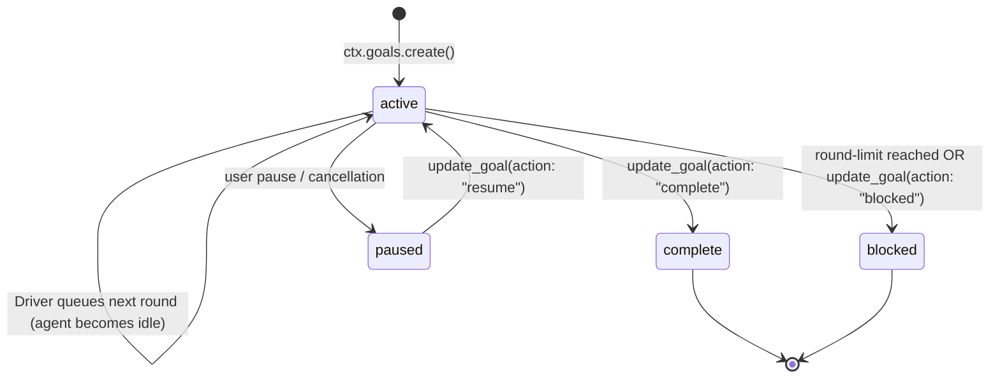

# DeepSeek Harness: Goal Preset Tutorial & Test Scenarios

This directory contains standalone, non-spec2gds scenarios designed to help understand and verify the **`goal` preset** in DeepSeek Harness (`dsh`).

---

## 1. What is the Goal Preset?

In DeepSeek Harness, presets configure how agents interact with tools, sessions, and multi-turn loops. The `goal` preset transforms an agent from a single-turn conversational assistant into an **autonomous long-running goal-oriented engine**.

### Key Architectural Concepts

| Component | Responsibility |
|---|---|
| **`GoalService`** (`@deepseek-ai/dsh-goal`) | Maintains durable goal state (`id`, `revision`, `objective`, `phase`, `activation`, `roundsStarted`, `maxGoalRounds`). Uses compare-and-set revision fencing to avoid race conditions. |
| **`GoalRoundDriver`** (`@deepseek-ai/dsh-goal-round-driver`) | Monitors whole-agent quiescence (`agent.status === 'idle'`). When active and armed, it automatically constructs a `<goal_round>` continuation prompt and queues the next turn until `complete`, `blocked`, `paused`, or `maxGoalRounds` limit is reached. |
| **`ToolGoal`** (`@deepseek-ai/dsh-tool-goal`) | Registers `get_goal`, `create_goal`, and `update_goal` tools. Allows the model to inspect its current goal, check its round budget, and signal `complete` when done. |
| **Domain Tools** (`src/tools.ts`) | Safe execution sandboxes providing `inspect_csv`, `execute_python_code` (via `uv run --with pandas`), `write_file`, and `read_file`. |

### Goal Lifecycle State Machine



---

## 2. Test Scenarios Overview

We provide two data-oriented scenarios that operate on real e-commerce data:

### Scenario 1: Multi-Step CSV Data Explorer & Cleaner
* **Initial Dataset**: [`data/raw_sales_data.csv`](data/raw_sales_data.csv) contains dirty entries: duplicate orders, dollar signs and commas in numeric fields, inconsistent status codes (`DLVD` vs `Delivered`), and missing values.
* **Round 1 (Inspection)**: The agent calls `inspect_csv` to calculate column null counts, row counts, duplicate counts, and inspect samples.
* **Round 2 (Cleaning & Execution)**: The agent authors `output/clean_sales_data.py` (using Pandas) and runs `execute_python_code` to produce `output/cleaned_sales_data.csv`.
* **Round 3 (Documentation & Completion)**: The agent creates `output/data_profile.md` summarizing the data hygiene fixes, calls `get_goal` to read its current revision, calls `update_goal(action: "complete")`, and confirms completion.

### Scenario 2: Automated Pandas Data Analysis & Reporting
* **Input Dataset**: `output/cleaned_sales_data.csv` (auto-generated if missing).
* **Round 1 (Verification)**: The agent inspects the cleaned CSV to verify clean schema and non-null rows.
* **Round 2 (Metrics Computation)**: The agent writes `output/analyze_sales.py`, executing aggregate aggregations (total revenue, average order value, breakdown by product category).
* **Round 3 (Executive Report & Completion)**: The agent drafts `output/sales_insights.md` with findings and actionable recommendations, then completes the goal via `update_goal(action: "complete")`.

---

## 3. Directory Layout

```
examples/goal-preset-scenarios/
├── README.md                      # This guide
├── run.sh                         # Convenient runner script (auto-detects Node 22+)
├── run.ts                         # Standalone executable CLI runner
├── vitest.config.ts               # Isolated Vitest test configuration
├── data/
│   └── raw_sales_data.csv         # Realistic sample e-commerce transactions
├── output/                        # Generated by running scenarios
│   ├── clean_sales_data.py
│   ├── cleaned_sales_data.csv
│   ├── data_profile.md
│   ├── analyze_sales.py
│   └── sales_insights.md
├── src/
│   ├── tools.ts                   # Domain tools (inspect_csv, execute_python_code, write_file, read_file)
│   ├── preset.ts                  # Preset mounting helper (GoalService + Driver + ToolGoal)
│   ├── scenario_cleaner.ts        # Scenario 1 prompts & objectives
│   └── scenario_analyzer.ts       # Scenario 2 prompts & objectives
└── tests/
    └── scenarios.spec.ts          # Vitest test suite for both scenarios
```

---

## 4. How to Run

### Option A: Run Automated Test Suite (Offline Verification)

Run the Vitest suite using the dedicated config:

```bash
# Ensure Node 22+ is active
export PATH="$HOME/.nvm/versions/node/v22.23.2/bin:$PATH"

# Run tests
pnpm exec vitest run -c examples/goal-preset-scenarios/vitest.config.ts
```

Output:
```
✓ Goal Preset Data Scenarios (2)
  ✓ Scenario 1: autonomously inspects raw CSV, writes cleaning script, executes it, and documents findings across 3 rounds (1017ms)
  ✓ Scenario 2: analyzes cleaned sales data, generates pandas script, and produces insights report (972ms)

Test Files  1 passed (1)
     Tests  2 passed (2)
```

---

### Option B: Interactive CLI Runner (Mock / Offline Mode)

You can run either scenario through the interactive terminal runner without requiring any external LLM API key:

#### Run Scenario 1 (CSV Exploration & Cleaner):
```bash
./examples/goal-preset-scenarios/run.sh --scenario 1 --mock
```

#### Run Scenario 2 (Pandas Analysis & Reporting):
```bash
./examples/goal-preset-scenarios/run.sh --scenario 2 --mock
```

The runner will output real-time tool calls, tool results, round transitions, and print the generated markdown reports upon goal completion.

---

### Option C: Run with Real LLM (OpenAI / DeepSeek / Custom Gateway)

If you have an OpenAI or DeepSeek API key, you can run the agent live:

#### OpenAI (`gpt-4o-mini`):
```bash
OPENAI_API_KEY="sk-..." ./examples/goal-preset-scenarios/run.sh \
  --scenario 1 \
  --provider openai \
  --model gpt-4o-mini
```

#### DeepSeek Official (`deepseek-chat`):
```bash
DEEPSEEK_API_KEY="sk-..." ./examples/goal-preset-scenarios/run.sh \
  --scenario 2 \
  --provider deepseek \
  --model deepseek-chat
```

#### Custom Base URL / Gateway:
```bash
./examples/goal-preset-scenarios/run.sh \
  --scenario 1 \
  --provider openai \
  --model my-model \
  --api-key "sk-..." \
  --base-url "https://my-gateway.example.com/v1"
```

---

## 5. What Makes `goal` Preset Special?

1. **No External For-Loops Needed**: You do not have to write `while (!done)` loops around the agent. The agent loop and `GoalRoundDriver` coordinate natively.
2. **Crash-Resilient State**: Goal metadata is persisted and revision-fenced. If an agent step hangs or fails, the goal can be paused or resumed cleanly.
3. **Safety Caps**: `maxGoalRounds` prevents runaway recursion or runaway API cost.
4. **Tool-Driven Self-Completion**: The LLM determines when its task is truly finished by calling `update_goal(action: "complete")`.
