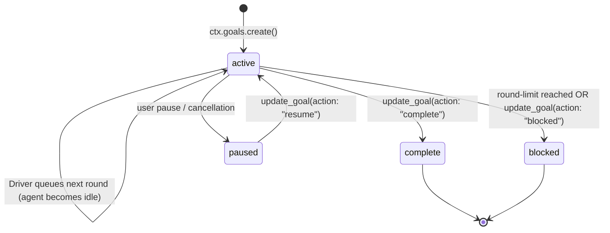

# DeepSeek Harness：目标预设教程和测试场景

[English](README.md) | 中文

本目录包含独立场景，用于了解和验证 DeepSeek Harness（`dsh`）的 **`goal` 预设**。

---

## 1. 什么是目标预设？

DeepSeek Harness 的预设配置代理使用工具、会话和多轮循环的方式。`goal` 预设让代理在多轮交互中继续执行一个目标。

### 主要组件

| 组件 | 职责 |
|---|---|
| **`GoalService`** (`@deepseek-ai/dsh-goal`) | 保存持久目标状态（`id`、`revision`、`objective`、`phase`、`activation`、`roundsStarted`、`maxGoalRounds`）。更新时核对修订版本，避免并发更新冲突。 |
| **`GoalRoundDriver`** (`@deepseek-ai/dsh-goal-round-driver`) | 监测代理是否空闲（`agent.status === 'idle'`）。在目标仍可执行时构造 `<goal_round>` 提示并排队下一轮，直到状态为 `complete`、`blocked`、`paused` 或达到 `maxGoalRounds`。 |
| **`ToolGoal`** (`@deepseek-ai/dsh-tool-goal`) | 注册 `get_goal`、`create_goal` 和 `update_goal`。模型可以检查当前目标和轮次预算，并在完成时发送 `complete`。 |
| **Domain Tools** (`src/tools.ts`) | 示例工具包括 `inspect_csv`、`execute_python_code`（通过 `uv run --with pandas`）、`write_file` 和 `read_file`。 |

### 目标生命周期状态机



---

## 2. 测试场景概述

以下两个场景处理电子商务交易数据。

### 场景 1：检查和清理 CSV 数据
* **原始数据**：[`data/raw_sales_data.csv`](data/raw_sales_data.csv) 包含重复订单、数值字段中的货币符号和逗号、不一致的状态（`DLVD` 和 `Delivered`）以及缺失值。
* **第 1 轮（检查）**：代理调用 `inspect_csv` 统计空值、总行数和重复行，并查看样本。
* **第 2 轮（清理）**：代理用 Pandas 编写 `output/clean_sales_data.py`，并通过 `execute_python_code` 生成 `output/cleaned_sales_data.csv`。
* **第 3 轮（记录）**：代理在 `output/data_profile.md` 中记录清理结果，通过 `get_goal` 读取当前修订版本，调用 `update_goal(action: "complete")` 并确认完成。

### 场景 2：用 Pandas 分析数据并生成报告
* **输入数据**：`output/cleaned_sales_data.csv`。文件缺失时自动生成。
* **第 1 轮（验证）**：代理检查清理后的 CSV，验证字段结构和非空行。
* **第 2 轮（计算）**：代理编写 `output/analyze_sales.py` 计算总收入、平均订单金额和商品类别统计。
* **第 3 轮（报告）**：代理在 `output/sales_insights.md` 中记录发现和建议，然后调用 `update_goal(action: "complete")` 完成目标。

---

## 3. 目录布局

```
examples/goal-preset-scenarios/
├── README.md                      # This guide
├── run.sh                         # Convenient runner script (auto-detects Node 22+)
├── run.ts                         # Standalone executable CLI runner
├── vitest.config.ts               # Isolated Vitest test configuration
├── data/
│   └── raw_sales_data.csv         # Realistic sample e-commerce transactions
├── output/                        # Generated by running scenarios
│   ├── clean_sales_data.py
│   ├── cleaned_sales_data.csv
│   ├── data_profile.md
│   ├── analyze_sales.py
│   └── sales_insights.md
├── src/
│   ├── tools.ts                   # Domain tools (inspect_csv, execute_python_code, write_file, read_file)
│   ├── preset.ts                  # Preset mounting helper (GoalService + Driver + ToolGoal)
│   ├── scenario_cleaner.ts        # Scenario 1 prompts & objectives
│   └── scenario_analyzer.ts       # Scenario 2 prompts & objectives
└── tests/
    └── scenarios.spec.ts          # Vitest test suite for both scenarios
```

---

## 4. 运行方式

### 方式 A：运行离线自动测试

使用专用配置运行 Vitest。

```bash
# Ensure Node 22+ is active
export PATH="$HOME/.nvm/versions/node/v22.23.2/bin:$PATH"

# Run tests
pnpm exec vitest run -c examples/goal-preset-scenarios/vitest.config.ts
```

输出：
```
✓ Goal Preset Data Scenarios (2)
  ✓ Scenario 1: autonomously inspects raw CSV, writes cleaning script, executes it, and documents findings across 3 rounds (1017ms)
  ✓ Scenario 2: analyzes cleaned sales data, generates pandas script, and produces insights report (972ms)

Test Files  1 passed (1)
     Tests  2 passed (2)
```

---

### 方式 B：离线运行交互式命令

本地模拟模式可以在终端运行两个场景，无需外部模型 API 密钥。

#### 运行场景 1（检查和清理 CSV）
```bash
./examples/goal-preset-scenarios/run.sh --scenario 1 --mock
```

#### 运行场景 2（Pandas 分析和报告）
```bash
./examples/goal-preset-scenarios/run.sh --scenario 2 --mock
```

运行器实时输出工具调用、工具结果和轮次变化，并在目标完成后打印 Markdown 报告。

---

### 方式 C：使用在线模型（OpenAI、DeepSeek 或自定义网关）

可以通过 OpenAI 或 DeepSeek API 密钥运行在线场景。

#### OpenAI（`gpt-4o-mini`）
```bash
OPENAI_API_KEY="sk-..." ./examples/goal-preset-scenarios/run.sh \
  --scenario 1 \
  --provider openai \
  --model gpt-4o-mini
```

#### DeepSeek 官方服务（`deepseek-chat`）
```bash
DEEPSEEK_API_KEY="sk-..." ./examples/goal-preset-scenarios/run.sh \
  --scenario 2 \
  --provider deepseek \
  --model deepseek-chat
```

#### 自定义 URL 或网关
```bash
./examples/goal-preset-scenarios/run.sh \
  --scenario 1 \
  --provider openai \
  --model my-model \
  --api-key "sk-..." \
  --base-url "https://my-gateway.example.com/v1"
```

---

## 5. `goal` 预设的作用

1. **继续执行**：代理循环与 `GoalRoundDriver` 协作，无需外部 `while (!done)` 循环。
2. **状态恢复**：目标元数据持久保存，更新时检查修订版本。某一步挂起或失败后，可以暂停或恢复目标。
3. **轮次上限**：`maxGoalRounds` 限制连续执行的轮次和 API 调用成本。
4. **完成操作**：模型确定其工作完成后，调用 `update_goal(action: "complete")`。
